# Лабораторная 9 - Git

## На оценку 3:
1: Используя команду status, понимаем что находимся в ветке main
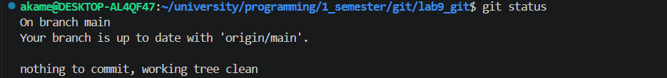

2: Смотрим историю коммитов

3: Создание файла sort.c и вставление в его функции пузырьковой сортировки

4: смотрим status после выше описанных действий. И видим изменения

5-6: Добавляем файл в область stage и проверяем status.
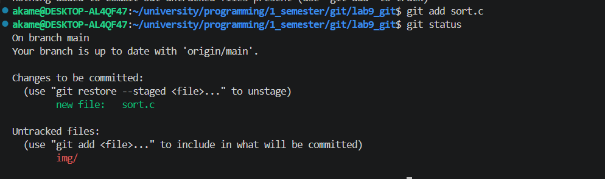

7: Коммитим файл в репозиторий

8: 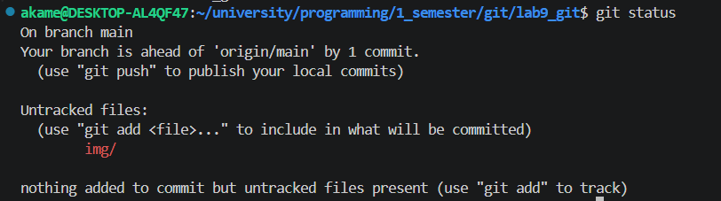

9: 

10: 

11: 

12: 

13: 

14: 

15: 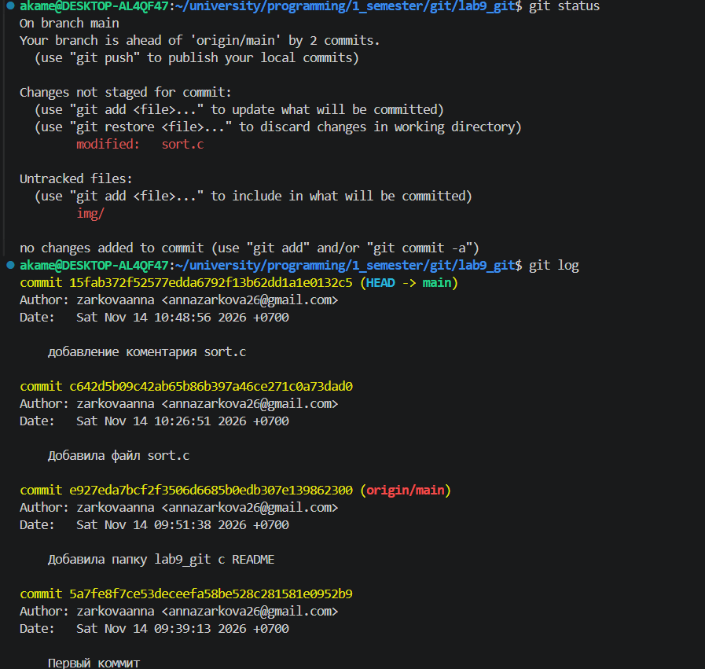

16: 

17: 

### ветки
1) 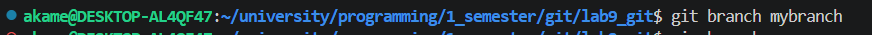

2) 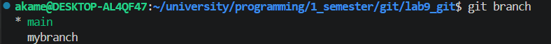

3) 

4) При переключении меняется название текущей ветки в строке On branch ... (с main на mybranch).

5) 

6) 

7) 

8) 

9) 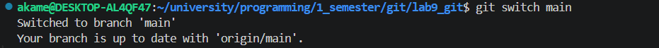

10) После переключения на main последний коммит из ветки mybranch (с file1.txt) больше не отображается в истории, потому что HEAD теперь указывает на предыдущий коммит.

11) 

12) 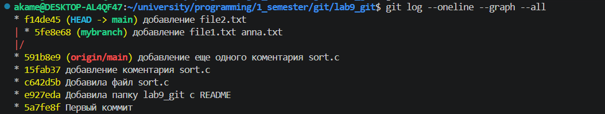

13) 

14) Да, файл file2.txt пропал из рабочей директории, так как он был создан и закоммичен только в ветке master, а в mybranch его нет.

15) 

16) 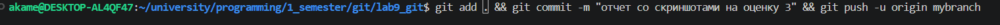

17) 

## На оценку 4:
1-2:
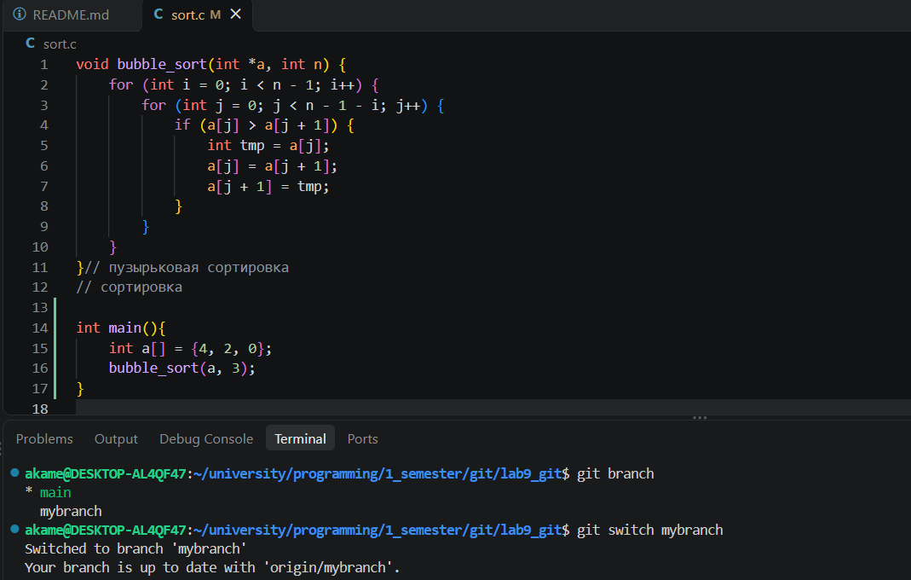

3-5: diff показывает добавленную функцию main() в рабочей директории, а diff --staged пустой, так как изменения ещё не проиндексированы.
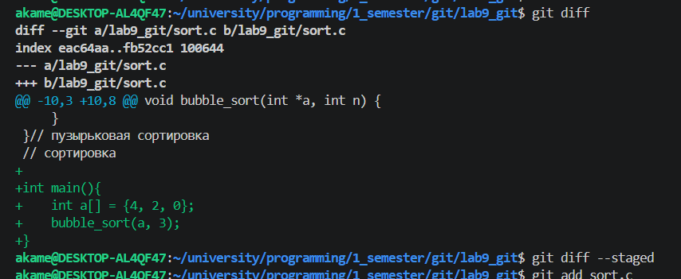

6-11: После add вывод diff пустой, а diff --staged показывает добавление main(). После удаления числа из массива diff показывает удаление элемента, а diff --staged — прежнюю версию с полным массивом. Это происходит потому, что первая правка уже зафиксирована в staged, а вторая осталась только в рабочей директории.
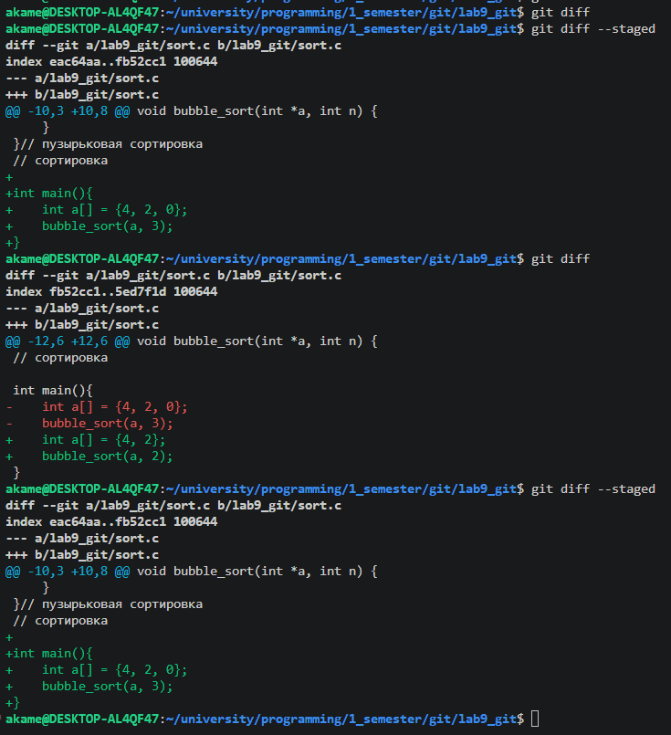

12-14: status сначала показывает sort.c дважды. После restore --staged sort.c индексация отменяется, и файл отображается один раз в разделе неиндексированных изменений.
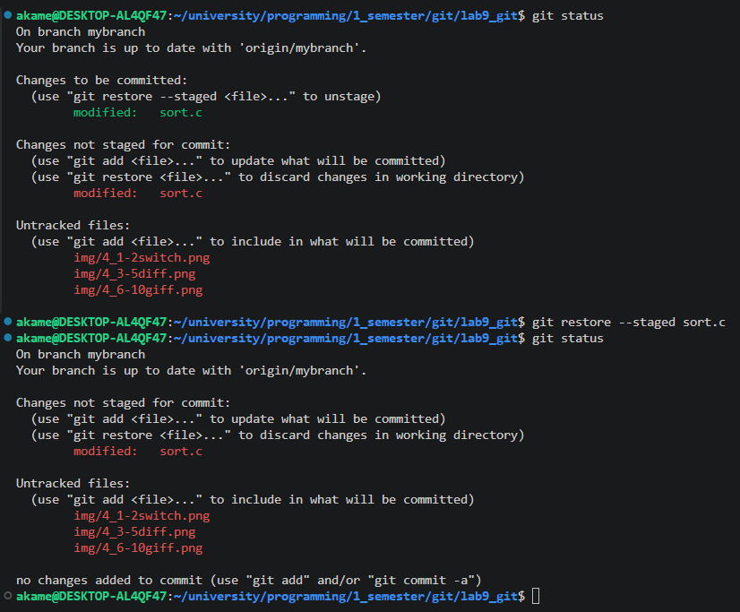

15:
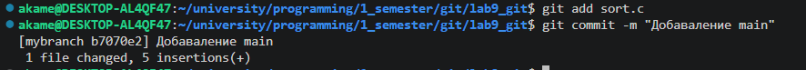

16: В журнале отображается новый коммит в ветке mybranch.
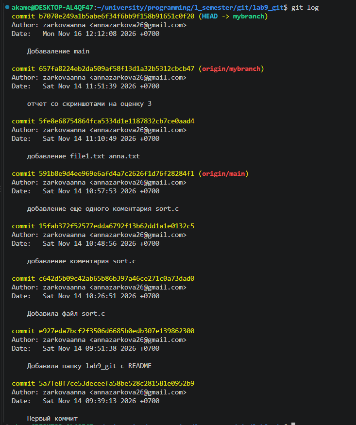

17-19: В sort.c добавлена строка printf("hello git\n");, git status показывает, что файл sort.c изменён, но не проиндексирован.
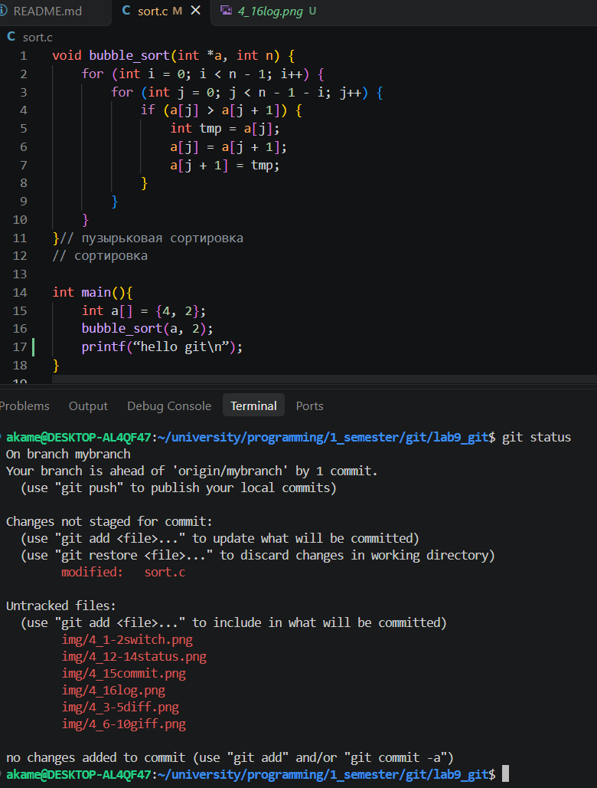

20-21: Команда откатила несохранённые правки, и содержимое sort.c вернулось к состоянию последнего коммита.
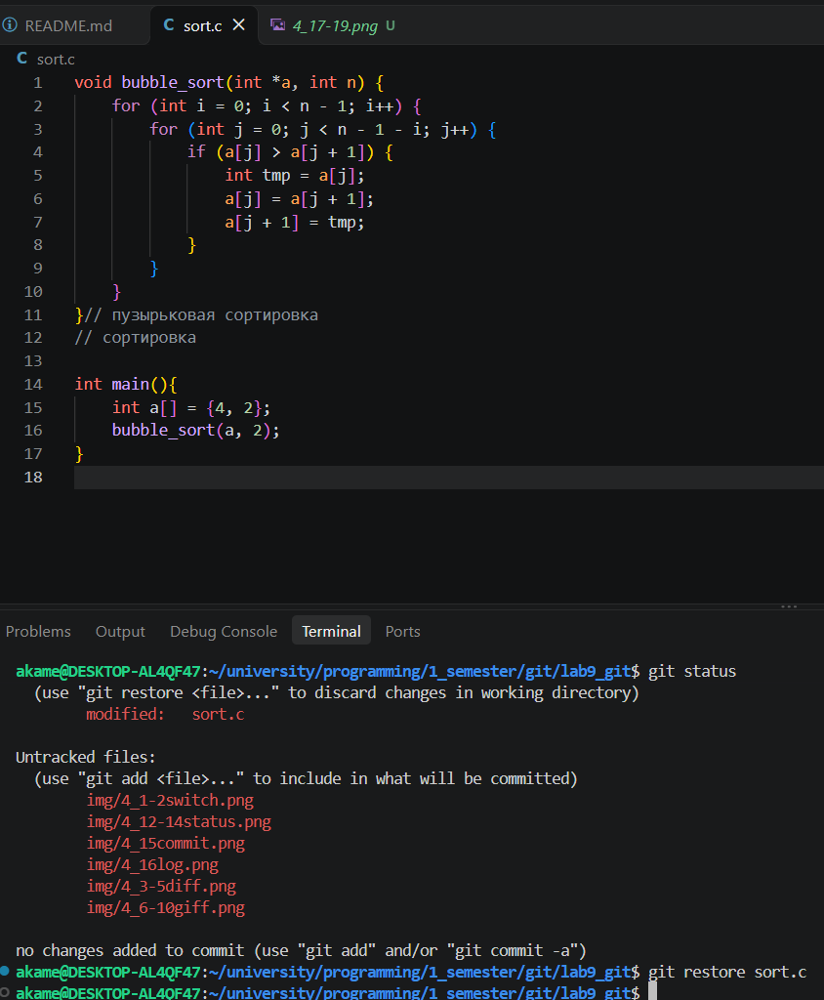

22-23: status сообщает, что директория чиста, после чего ветка отправлена на удалённый репозиторий.
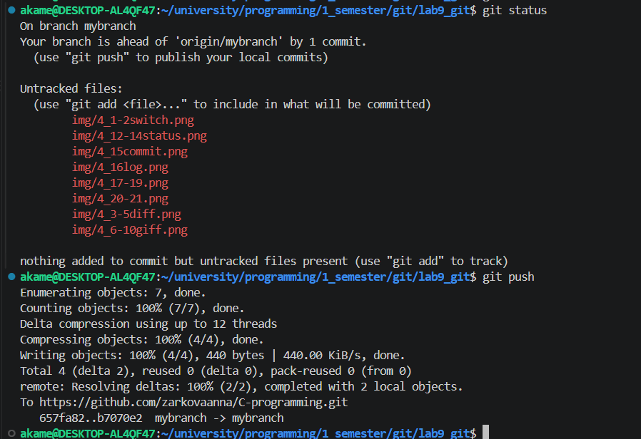

### Ветки и ff-merge

1-7: Создан и закоммичен greeting.txt со словом hello, создана ветка feature/uppercase, текст изменён на HELLO и закоммичен.
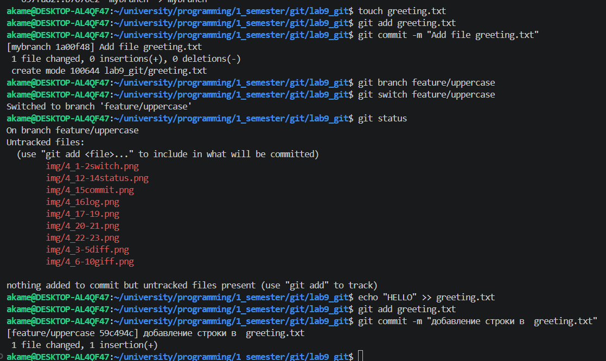

8-13: branch отмечает текущую ветку, а log --oneline --graph --all показывает, что она опережает главную ветку на один коммит. После переключения на главную ветку cat greeting.txt выводит hello, diff показывает разницу между hello и HELLO, а merge объединяет ветки(я случайно закрыла vs и терминал очистился...).
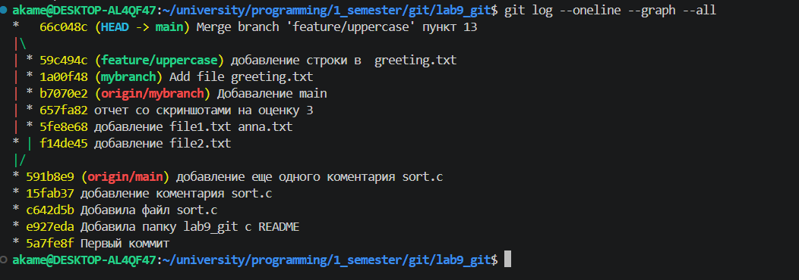

14-16: После слияния cat greeting.txt выводит HELLO, ветка feature/uppercase удалена, а ветка mybranch смержена в main.
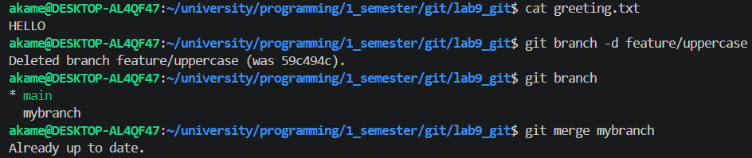

17-18: log --oneline --graph --all показывает единую объединённую историю всех коммитов, после чего изменения ветки main отправлены на удалённый репозиторий.
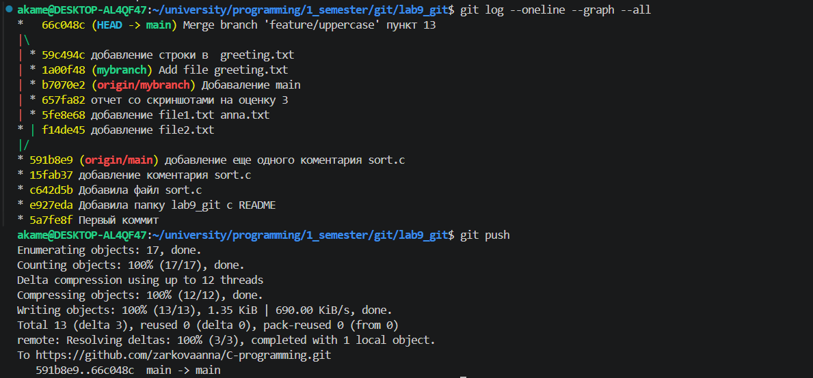

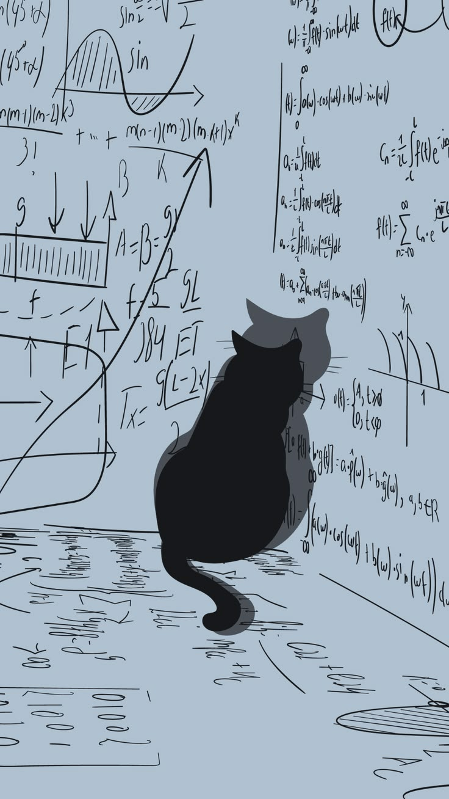