# Лабораторная 9 - Git

## На оценку 3:
1) Используя команду status, понимаем что находимся в ветке main

2) Смотрим историю коммитов
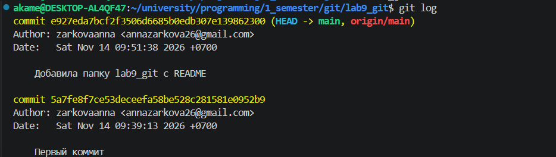
3) Создание файла sort.c и вставление в его функции пузырьковой сортировки
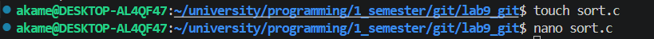
4) смотрим status после выше описанных действий. И видим изменения
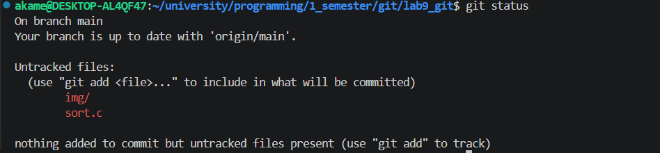
5-6) Добавляем файл в область stage и проверяем status.

7) Коммитим файл в репозиторий
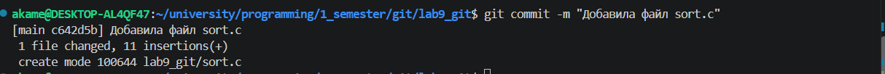
8) 
9) 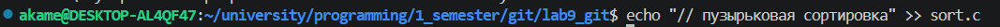
10) 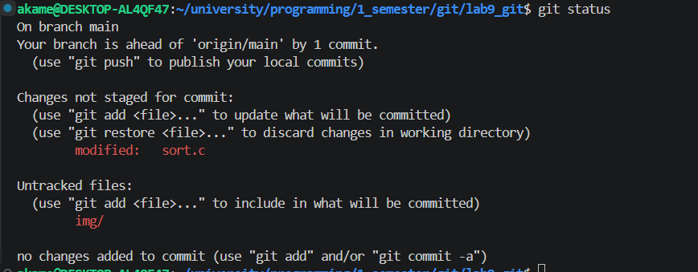
11) 
12) 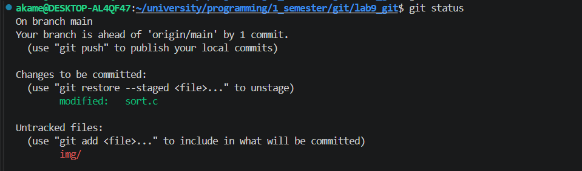
13) 
14) 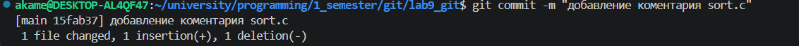
15) 
16) 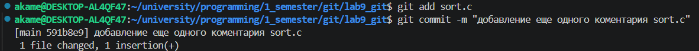
17) 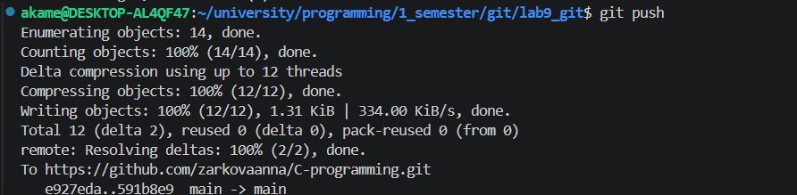

### ветки
1) 
2) 
3) 
4) При переключении меняется название текущей ветки в строке `On branch ...` (с `main` на `mybranch`).
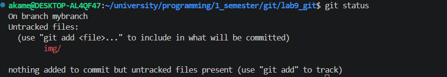
5) 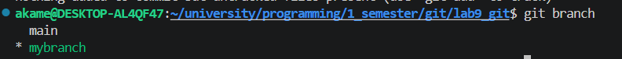
6) 
7) 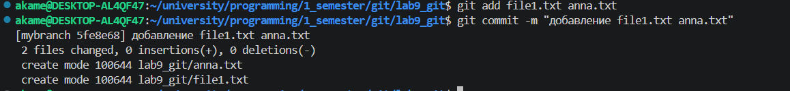
8) 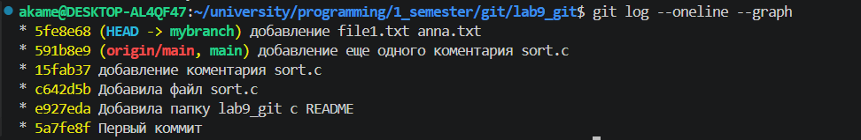
9) 
10) После переключения на `main` последний коммит из ветки `mybranch` (с `file1.txt`) больше не отображается в истории, потому что `HEAD` теперь указывает на предыдущий коммит.
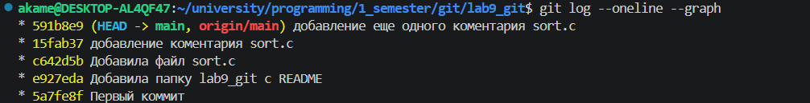
11) 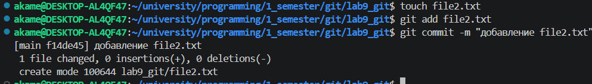
12) 
13) 
14) Да, файл `file2.txt` пропал из рабочей директории, так как он был создан и закоммичен только в ветке `master`, а в `mybranch` его нет.

15) 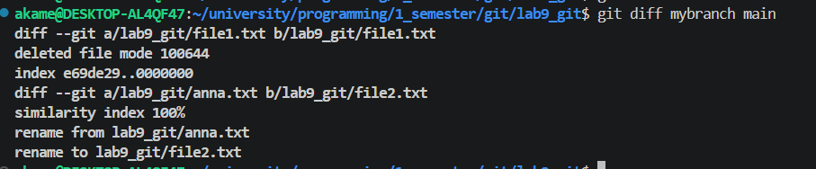
16) 
17) 